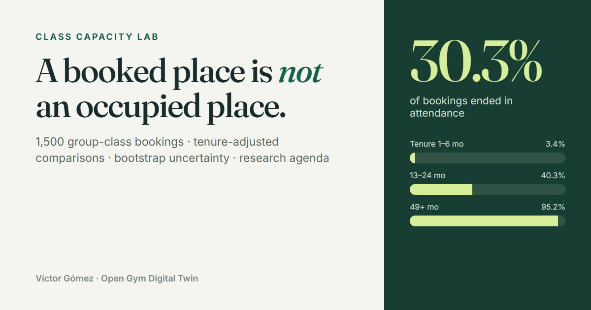
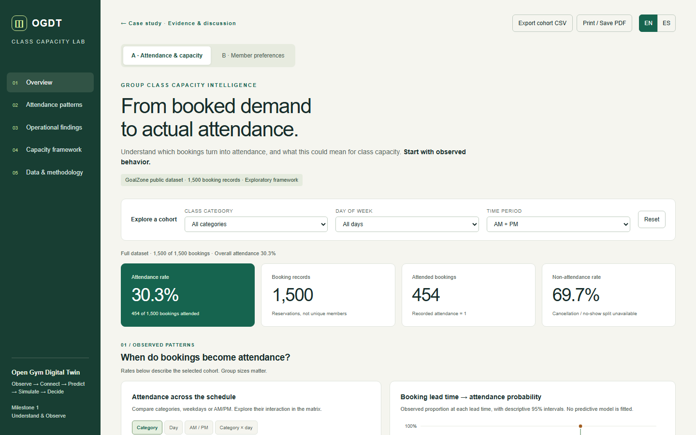

# Class Capacity Lab

**A booked place is not an occupied place.** Exploratory analysis of group-class bookings and member preferences: the first module (*Observe*) of an Open Gym Digital Twin.

**Live site:** [class-capacity-lab.vercel.app](https://class-capacity-lab.vercel.app) · [Interactive dashboard](https://class-capacity-lab.vercel.app/dashboard) · [Evidence & discussion](https://class-capacity-lab.vercel.app/evidence) · English / Español



## Key findings

| | Result | Reading |
|---|---|---|
| Realized attendance | **454 / 1,500 bookings (30.3%)** | Bookings overstate occupancy by a wide margin. Cancellations and no-shows can't be separated in the source. |
| Membership tenure | **r = 0.486** (95% bootstrap 0.452–0.525) | Attendance rises from 3.4% (1–6 months) to 95.2% (49+ months). The direction matches the habit and attrition literature, but the size is implausibly large for real data. |
| Booking lead time | **r = 0.024** (−0.022 to 0.074); 0.026 tenure-adjusted | No linear signal, unlike clinical no-show research. Worth retesting with real timestamps. |
| AM vs. PM | Gap **5.4 → 4.0 pp** with a common tenure mix (CI −0.6 to 8.5) | The apparent morning advantage is not dependable. |
| Class category | Cramér's V = 0.05; ranking flips after standardization | Aqua leads raw rates; HIIT leads once tenure mix is held constant. |
| Member preferences (synthetic) | Pilates → Yoga lift **1.12** (0.71–1.53) | Overlap, not reliable co-preference or cross-sell evidence. |

No causal effects, prediction model or overbooking rule is claimed. See [Evidence & discussion](https://class-capacity-lab.vercel.app/evidence) for how these results compare with 14 peer-reviewed sources, and for a research agenda that richer gym data would enable.



## What's in the site

- **Case study** (`site/index.html`): problem, findings, method, limits and the digital-twin roadmap (Observe → Connect → Predict → Simulate → Decide).
- **Dashboard** (`site/dashboard.html`): two independent datasets, cohort filters, effect sizes with bootstrap intervals, tenure-standardized comparisons, preference matrices and association rules. Everything is in one self-contained HTML file with hand-written SVG charts. It works offline and switches between EN and ES at runtime.
- **Evidence & discussion** (`site/evidence.html`): written like the discussion section of a paper. It covers no-shows and lead time, tenure, habit and attrition, group dynamics, reminders and megastudies, overbooking and calibration, then strengths and limitations and a research agenda. References are verified against Crossref and PubMed.

## Data

| Dataset | Rows | Role | Rights |
|---|---|---|---|
| GoalZone fitness-class bookings | 1,500 | Attendance & capacity (A) | Public educational dataset. Redistribution terms are unconfirmed, so **raw rows are not in this repository or the public site**. |
| [Gym Membership Dataset](https://www.kaggle.com/datasets/ka66ledata/gym-membership-dataset), Tarek Adam | 1,000 | Member preferences (B) | CC0. **Synthetic**, so it shows techniques only. |

The datasets are never joined. The public dashboard replaces GoalZone booking rows with a contingency table of counts (category × weekday × AM/PM × lead time × tenure band, 402 cells). The analysis output is identical to the local build, which was verified across filter combinations. Row-level export is disabled for Dataset A.

## Methods

Source reconciliation (CSV ↔ Parquet), point-biserial correlation, uncorrected Cramér's V, Wilson intervals, deterministic 1,000-resample percentile bootstrap, direct standardization over five tenure strata, linear partial correlation, and set-based support/confidence/lift. Details are in [`docs/methodology.md`](docs/methodology.md) and [`docs/association_analysis.md`](docs/association_analysis.md). The notebook is [`notebooks/03_associations_and_tenure.ipynb`](notebooks/03_associations_and_tenure.ipynb).

## Reproduce

Requires Python with `pandas` and `pyarrow` (`requirements.txt`). Put the source CSVs at the paths described in [`docs/source_provenance.md`](docs/source_provenance.md), then run:

```bash
python src/build_analysis.py      # tables, docs, local dashboard.html (row-level, not committed)
python src/package_research.py    # notebook and research documents
python src/build_public_site.py   # site/dashboard.html: aggregated, bilingual
```

Preview the site with `python -m http.server -d site 8000`. The site is deployed as static files from `site/` on Vercel.

## Repository layout

```
site/            public website (case study, dashboard, evidence), deployed to Vercel
src/             analysis pipeline, dashboard templates, public build + ES dictionary
data/processed/  aggregated result tables (no booking rows)
docs/            data dictionary, quality, methodology, provenance
handoff/         findings, metric definitions, limitations, real-gym data contract
notebooks/       association and tenure notebook
reports/         verification evidence
```

## Next milestone

The next milestone needs real session data: session IDs and capacity, booking, cancellation and class timestamps, stable member IDs and verified attendance. The proposed contract is in [`handoff/data_contract.yaml`](handoff/data_contract.yaml). Only with that data does it make sense to fit calibrated attendance probabilities and simulate capacity rules.

---

Built by **Víctor Gómez**, physiotherapist, data scientist and AI builder · [Portfolio](https://victor-gomez-portfolio.vercel.app)
