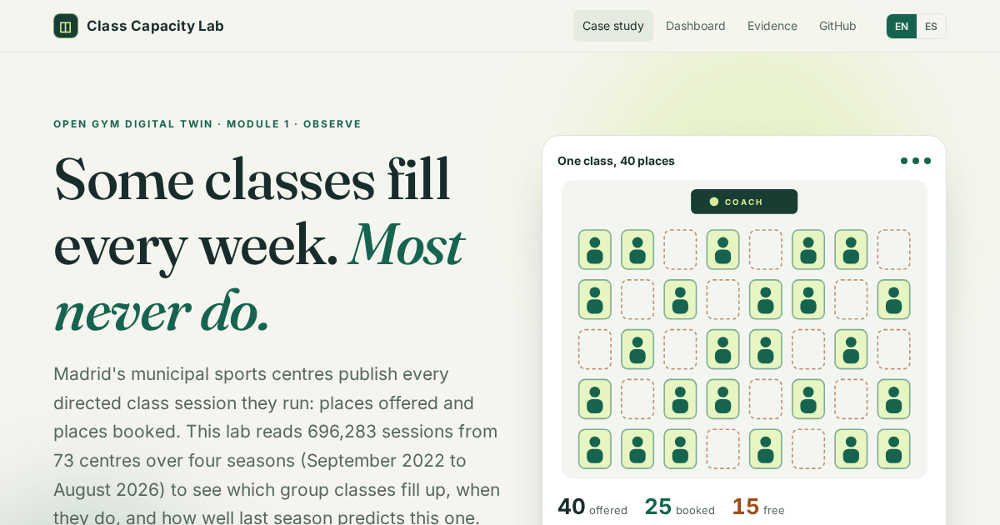
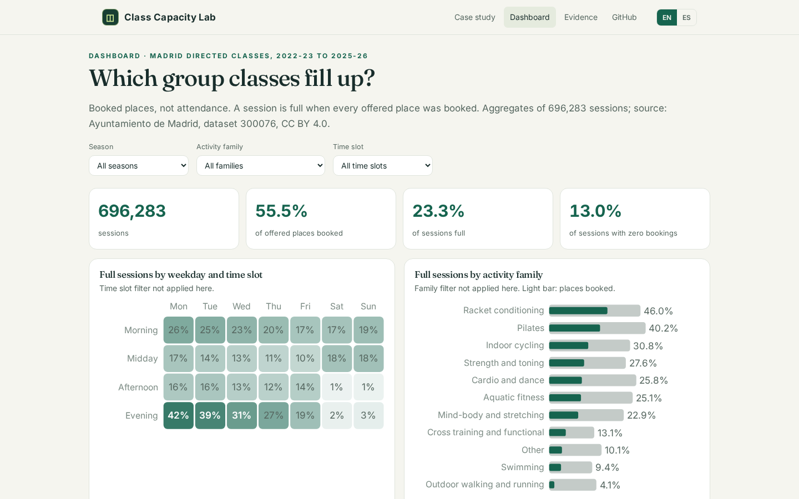

# Class Capacity Lab

**Some classes fill every week. Most never do.** Which group classes fill up, when, and how predictable it is, from four seasons of open session data published by Madrid's municipal sports centres. The first module (*Observe*) of an Open Gym Digital Twin.

**Live site:** [class-capacity-lab.vercel.app](https://class-capacity-lab.vercel.app) · [Interactive dashboard](https://class-capacity-lab.vercel.app/dashboard) · [Evidence & discussion](https://class-capacity-lab.vercel.app/evidence) · English / Español



## Key findings

All numbers come from `src/analysis.py` run on `data/processed/madrid_class_slots.csv.gz` (696,283 directed class sessions, 73 centres, September 2022 to August 2026).

| | Result | How it was computed |
|---|---|---|
| Booked share of places | **55.5%** overall; **61.6%** in 2025-26 (95% CI 57.1% to 65.8%) | Sum of booked places / sum of offered places. Interval: 1,000 bootstrap resamples of centres. |
| Fully booked sessions | **23.3%** overall; **27.4%** in 2025-26 (24.7% to 30.3%); up from 16.3% in 2022-23 | Sessions with booked = offered / all sessions. |
| Time of week | Monday evening **42.4%** full, Tuesday evening 38.6%; Saturday afternoon **1.2%** | Full rate by weekday x time slot (morning before 12, midday 12 to 15, afternoon 15 to 18, evening from 18). |
| Activity | Racket conditioning **46.0%**, Pilates 40.2%; swimming 9.4%, outdoor walking and running 4.1% | 928 activity names grouped into 11 families with keyword rules in `src/build_sessions.py`. |
| Association with being full | Cramér's V: activity 0.38, family 0.28, centre 0.22, slot 0.18, weekday 0.12, season 0.10, month 0.09 | Uncorrected V from the factor x full / not full table. |
| Season-to-season predictability | **AUC 0.81** (0.79 to 0.83) for 2025-26 ranked by the same slot's 2024-25 full rate; 0.74 with family x weekday x slot only; 0.81 to 0.82 over three season pairs | Session-weighted AUC; slot = centre, activity, weekday and start time; 54% to 66% of sessions have a matching slot. |
| Persistence | Slot occupancy correlates **0.83 to 0.85** across consecutive seasons | Session-weighted Pearson r over matching slots. |

No causal effects, fitted production model or overbooking rule is claimed. "Booked" is the source's *ocupadas*: places taken by a booking, not people counted in the room.



## Data

| Dataset | Rows used | Role | License |
|---|---|---|---|
| Ayuntamiento de Madrid, [Oferta y ocupación de plazas en actividades deportivas dirigidas](https://datos.madrid.es/dataset/300076-0-deportes-ocupacion) (300076), files "Clases abiertas y uso libre" for seasons 2022-23 to 2025-26 | 696,283 directed class sessions | Places offered and booked per session | [CC BY 4.0](https://creativecommons.org/licenses/by/4.0/) |

Attribution: *Fuente: Ayuntamiento de Madrid. Datos filtrados, reclasificados y agregados por Class Capacity Lab.* The Ayuntamiento does not endorse this project. Raw files are downloaded by `src/download_madrid.py` into `data/raw/madrid/` (not committed); the aggregated slot table derived from them is published here under the same license. Exclusions are logged in `data/processed/data_quality.json` and described in [`docs/data_quality.md`](docs/data_quality.md).

## Reproduce

Requires Python with `pandas` and `numpy` (`requirements.txt`; the notebook step also needs `nbformat`, `nbclient`, `ipykernel` and `matplotlib`).

```bash
python src/download_madrid.py      # four season CSVs into data/raw/madrid/ + data/source_manifest.json
python src/build_sessions.py       # cleaned, aggregated slot table + data quality log
python src/build_site.py           # result tables, site/assets/data.js and the three HTML pages
python src/package_notebook.py     # executed notebook + Kaggle copy
python -m unittest discover tests  # analysis and site checks
```

Preview the site with `python -m http.server -d site 8000`. The site is deployed as static files from `site/` on Vercel.

## Repository layout

```
site/             public website (case study, dashboard, evidence), deployed to Vercel
src/              download, cleaning, analysis, site build and notebook packaging
src/templates/    page templates; numbers are filled in by src/build_site.py
data/processed/   slot table (CC BY 4.0, derived), result tables, data quality log
docs/             data dictionary, data quality, methodology, provenance, next milestone
notebooks/        executed analysis notebook
delivery/kaggle/  Kaggle notebook, kernel metadata and the dataset it needs
tests/            unit tests for the analysis and the built site
```

## Next milestone

Session-level check-ins, waitlists and booking and cancellation times would turn booked demand into attendance and unmet demand. See [`docs/next_milestone.md`](docs/next_milestone.md).

---

Built by **Víctor Gómez**, physiotherapist, data scientist and AI builder · [Portfolio](https://victor-gomez-portfolio.vercel.app)
